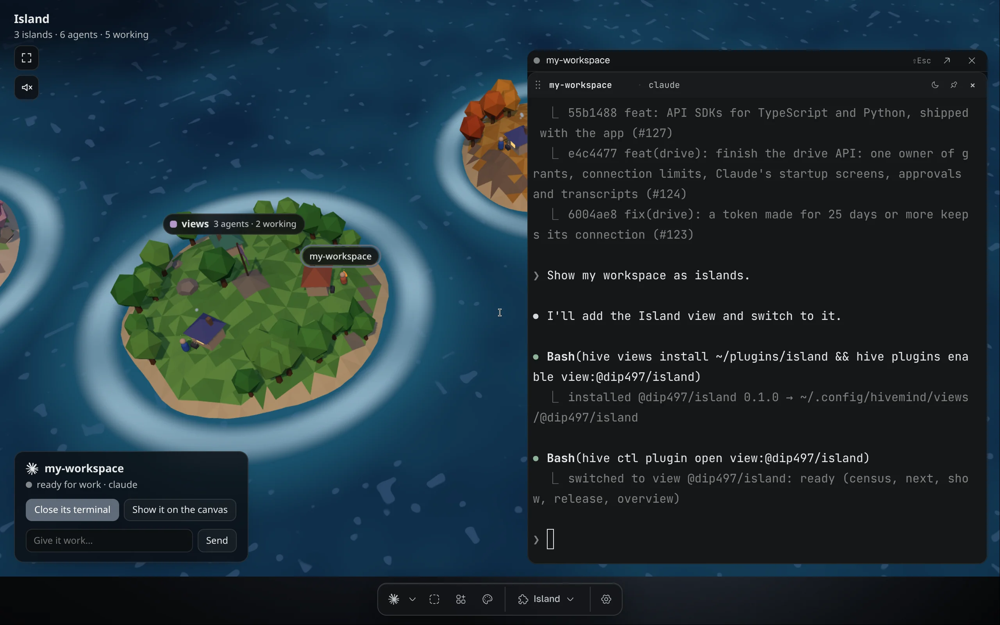
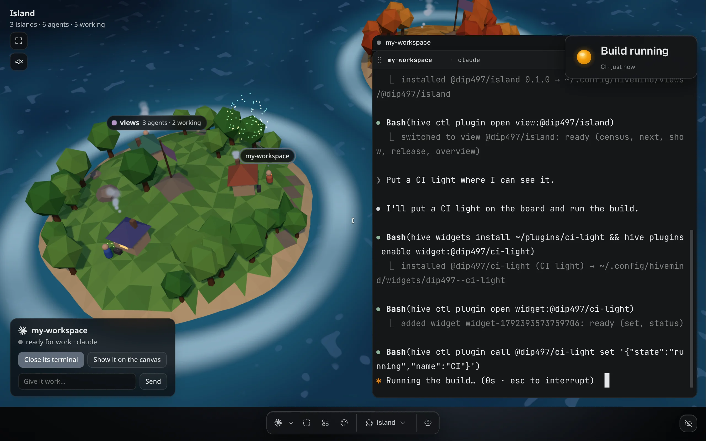
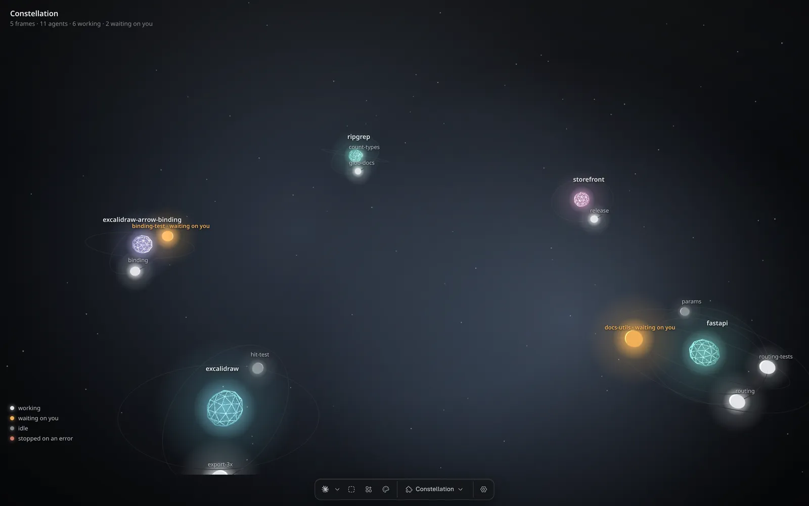

<p align="center">
  
</p>

<h1 align="center">Hivemind</h1>

<p align="center"><b>Your agents build the workspace they work in.</b></p>

<p align="center">
  <a href="https://hivemind.griiken.com/">Website</a> ·
  <a href="https://hivemind.griiken.com/guide/">Guide</a> ·
  <a href="https://hivehub.griiken.workers.dev/">HiveHub</a> ·
  <a href="https://github.com/dip497/hivemind/releases">Releases</a>
</p>

<p align="center">
  <a href="https://hivemind.griiken.com/"></a>
</p>

<p align="center"><sub>One prompt: <i>"Show my workspace as islands."</i> The agent installed the Island view and switched the app to it.</sub></p>

Every coding agent in a real terminal, on one board: Claude Code, Codex, Pi, and the one that ships
tomorrow. Then the fun part. Ask one for a view, a widget or a tool, and it writes it, installs it and
keeps it live. Nobody else has your workspace, because your agents made it for you.

Open source (MIT). Runs on your computer. No account.

## What you can do

- **Make the workspace yours.** The canvas is just the view it starts with. Views, widgets and tools
  are plugins, and your agents write them: `hive widgets new` makes a starter, the agent fills it in
  and keeps it up to date while it works.
- **Let agents drive it.** `hive ctl` is on every agent's PATH. An agent can open tiles, start other
  agents, read their answers and run a whole fan-out review. The same workspace has an API with
  TypeScript and Python SDKs, so a script can do it too.
- **Work on other machines.** Open a folder on any machine you reach over ssh; its agents run there.
- **Take it with you.** A phone page through your own `hive-net` server, and invite links that bring
  someone into your workspace.

<table>
  <tr>
    <td></td>
    <td></td>
  </tr>
  <tr>
    <td align="center"><sub>"Put a CI light where I can see it."</sub></td>
    <td align="center"><sub>A tool: which tests are flaky</sub></td>
  </tr>
  <tr>
    <td></td>
    <td align="center"></td>
  </tr>
  <tr>
    <td align="center"><sub>A view: every agent as a star</sub></td>
    <td align="center"><sub>Your agents, on your phone</sub></td>
  </tr>
</table>

<p align="center">
  <a href="https://hivehub.griiken.workers.dev/p/@dip497/dog"></a><br />
  <sub>Yes, there is a dog. His name is Biscuit. He is a widget.</sub>
</p>

More views, widgets and tools on [HiveHub](https://hivehub.griiken.workers.dev/), or ask your agent to
make one.

## Install

Linux x86_64 and macOS on Apple Silicon:

```bash
bash <(curl -fsSL https://hivemind.griiken.com/install.sh)
```

Windows x64, in PowerShell:

```powershell
irm https://hivemind.griiken.com/install.ps1 | iex
```

## Tech stack

**Yes, it's Electron. Please don't kill me.** 🙏 I'm a backend guy, and plugins your agents write
are web code anyway. Send hate mail to `/dev/null`.

[Contributing](./CONTRIBUTING.md) · [MIT licence](./LICENSE)
