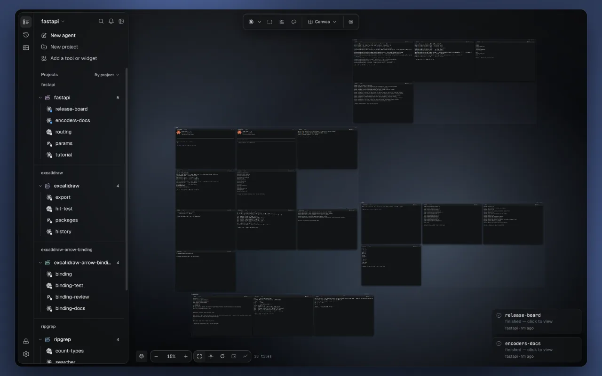
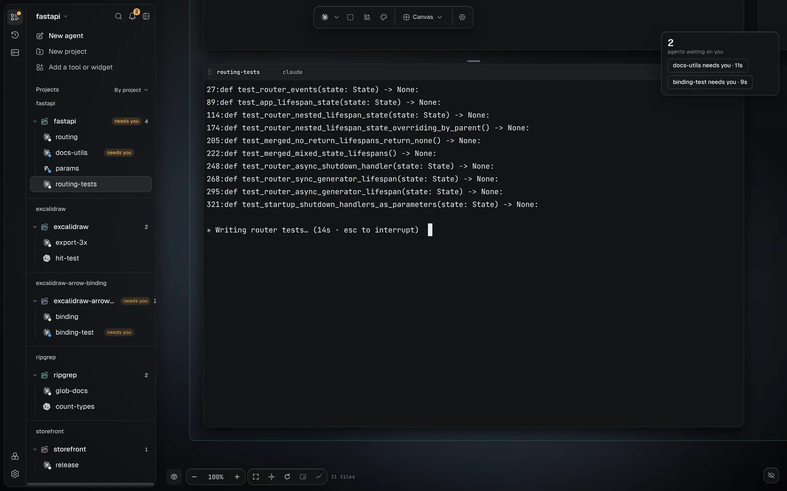
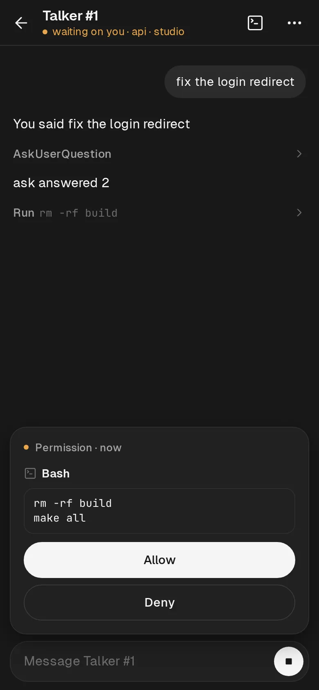

<p align="center">
  
</p>

<h1 align="center">Hivemind</h1>

<p align="center"><b>Run your coding agents side by side, and let them build the workspace they work in.</b></p>

<p align="center">
  <a href="https://hivemind.griiken.com/">Website</a> ·
  <a href="https://hivemind.griiken.com/guide/">Guide</a> ·
  <a href="https://hivehub.griiken.workers.dev/">HiveHub</a> ·
  <a href="https://github.com/dip497/hivemind/releases">Releases</a>
</p>

<p align="center">
  <a href="https://hivemind.griiken.com/"></a>
</p>

Hivemind is a desktop app for every coding agent that runs in a terminal: Claude Code, Codex, Pi,
and the one that ships tomorrow. Each agent gets a real terminal on one board, and you see at a glance which one
is working, which is done and which is waiting on you. MIT licensed, on your own computer, with no
account.

## What you can do

- **Make the workspace your own.** The canvas is only the view it starts with. Views, tools and
  widgets are plugins, and your agents write them: `hive widgets new` makes a starter, the agent
  fills it in, installs it and keeps it up to date while it works.
- **Drive it from agents and code.** `hive ctl` is on every agent's PATH, so an agent can open
  tiles, start other agents, read their answers and approve their prompts. The same workspace has an
  API with TypeScript and Python SDKs.
- **Work on other machines.** Open a folder on any machine you reach over ssh; its agents run there.
- **Answer from your phone, or bring someone in.** A phone page through your own `hive-net`
  server, and invite links that let another person join your workspace.
- **Every coding agent, in a real terminal.** Each tile shows whether its agent is working or
  needs you, and you answer its prompt in place.

<table>
  <tr>
    <td></td>
    <td></td>
  </tr>
  <tr>
    <td align="center"><sub>A widget: who is waiting on you</sub></td>
    <td align="center"><sub>A tool: which tests are flaky</sub></td>
  </tr>
  <tr>
    <td></td>
    <td align="center"></td>
  </tr>
  <tr>
    <td align="center"><sub>A view: every agent as a star</sub></td>
    <td align="center"><sub>Allow or deny from your phone</sub></td>
  </tr>
</table>

<p align="center">
  <a href="https://hivehub.griiken.workers.dev/p/@dip497/dog"></a><br />
  <sub>A widget that moves: Biscuit barks when an agent waits on you</sub>
</p>

More widgets, tools and views to try are on [HiveHub](https://hivehub.griiken.workers.dev/).

## Install

Linux x86_64 and macOS on Apple Silicon:

```bash
bash <(curl -fsSL https://hivemind.griiken.com/install.sh)
```

Windows x64, in PowerShell:

```powershell
irm https://hivemind.griiken.com/install.ps1 | iex
```

[Contributing](https://hivemind.griiken.com/guide/contributing/) · [MIT licence](./LICENSE)
