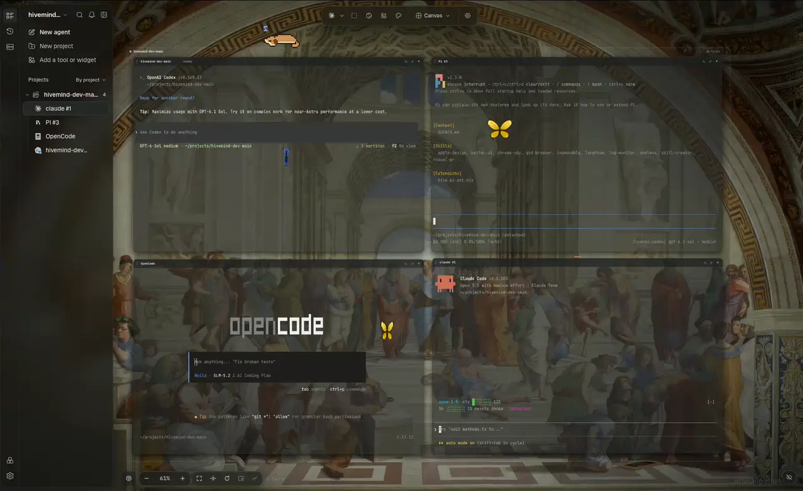
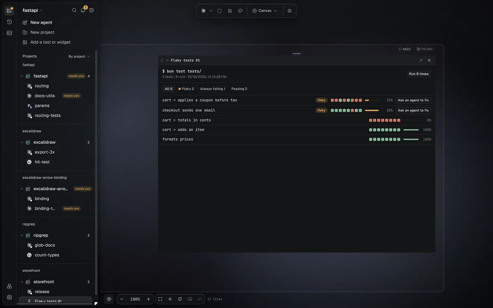
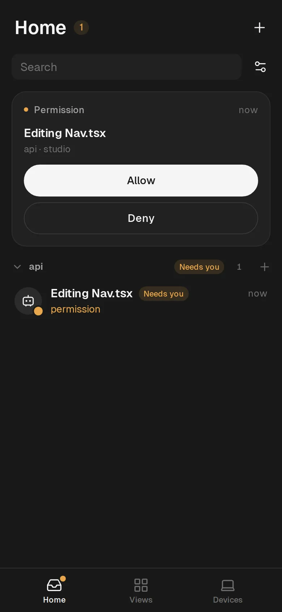
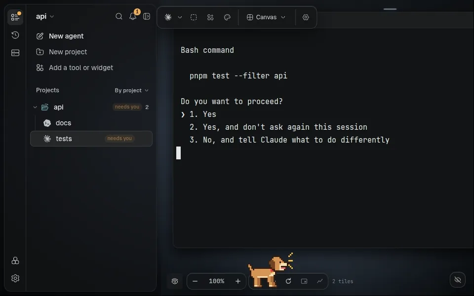

<sub>Everything below was written by AI. This line wasn't. — dip497</sub>

<p align="center">
  
</p>

<h1 align="center">Hivemind</h1>

<p align="center"><b>Your agents build the workspace they work in.</b></p>

<p align="center">A desktop app for Linux, macOS and Windows that runs Claude Code, Codex and every coding agent side by side.</p>

<p align="center">
  <a href="https://hivemind.griiken.com/">Website</a> ·
  <a href="https://hivemind.griiken.com/guide/">Guide</a> ·
  <a href="https://hivehub.griiken.workers.dev/">HiveHub</a> ·
  <a href="https://github.com/dip497/hivemind/releases">Releases</a>
</p>

> [!NOTE]
> **Yes, it's Electron. Please don't kill me.** 🙏 I'm a backend guy, and the plugins your agents
> write are web code anyway. Hate mail goes to `/dev/null`.

<p align="center">
  <a href="https://hivemind.griiken.com/"></a>
</p>

<p align="center"><sub>The School of Agents. <i>Wallpaper: Raphael, The School of Athens (1509–1511), public domain, via artwallpapers.biz.</i></sub></p>

Five agents in five terminal tabs?

Hivemind puts every coding agent on one board, each in a real terminal: Claude Code, Codex, Pi, and
whatever ships next week. Then it gets weird, in a good way. Ask an agent for a view, a widget or a
tool, and it builds one and plugs it in while you watch.

- **Bored of the canvas?** Ask for islands. Or butterflies. Or a dog. (There is a dog.)
- **Agents boss agents around.** With `hive ctl` an agent starts, reads and steers other agents.
  Your scripts can too, through the API.
- **Leave your desk.** Agents run on other machines over ssh, and you check on them from your phone.

<table>
  <tr>
    <td></td>
    <td align="center"></td>
  </tr>
  <tr>
    <td align="center"><sub>Which tests are flaky? Now you know.</sub></td>
    <td align="center"><sub>Your agents, in your pocket.</sub></td>
  </tr>
</table>

<p align="center">
  <a href="https://hivehub.griiken.workers.dev/p/@dip497/dog"></a><br />
  <sub>This is Biscuit. He is a widget. He is a good boy.</sub>
</p>

More weird stuff on [HiveHub](https://hivehub.griiken.workers.dev/), or ask your agent to make some.

## Install

Linux x86_64 and macOS on Apple Silicon:

```bash
bash <(curl -fsSL https://hivemind.griiken.com/install.sh)
```

Windows x64, in PowerShell:

```powershell
irm https://hivemind.griiken.com/install.ps1 | iex
```

Other ways to install, and what it puts where: https://hivemind.griiken.com/guide/install/.

[Contributing](./CONTRIBUTING.md) · [MIT licence](./LICENSE)
