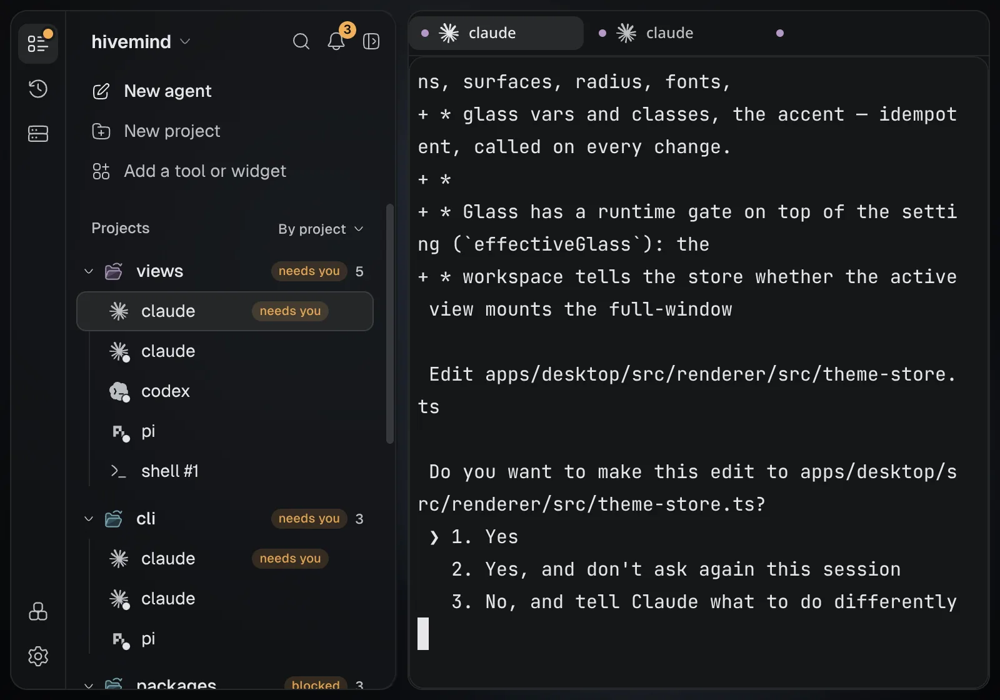
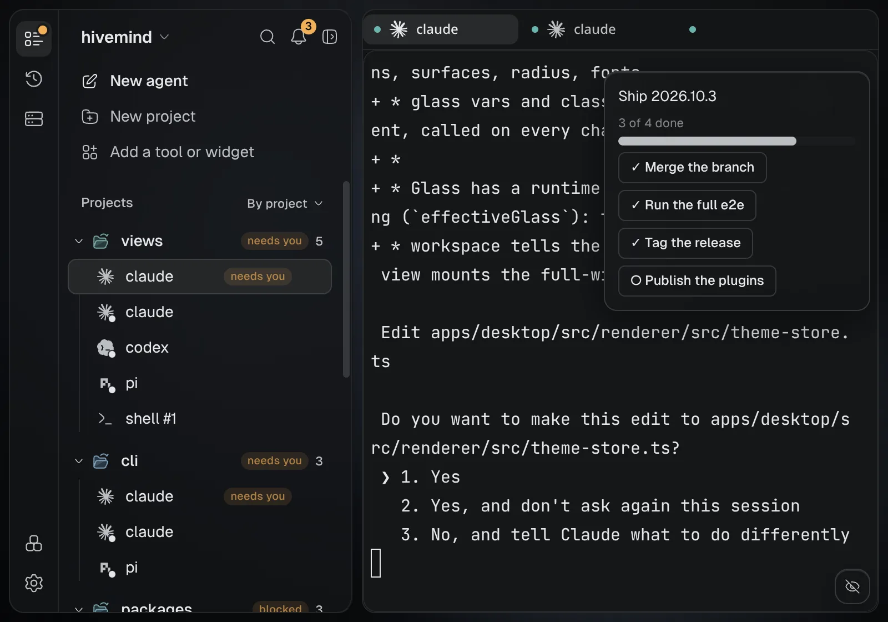

<p align="center">
  
</p>

<h1 align="center">hivemind</h1>

<p align="center"><b>Build the workspace your agents work in.</b><br />The screen is yours to draw; we keep the agents, terminals and diffs alive inside it.</p>

<p align="center">
  <a href="https://hivemind.griiken.com/">site</a> ·
  <a href="https://hivemind.griiken.com/guide/">docs</a> ·
  <a href="https://github.com/dip497/hivemind/releases">releases</a> ·
  <a href="https://hivehub.griiken.workers.dev/">plugins</a>
</p>

> *Four agents, four terminals, four tabs.* One is waiting for approval, one finished ten
> minutes ago, one is editing a file you meant to read first — and you find out by cycling
> through windows.

One screen instead. Each agent's terminal, the diff it is editing, the issues, a browser —
grouped into frames bound to a repo, a worktree or an SSH host.

- **Agents run agents.** `hive ctl` is on every agent's PATH, so one spawns three more, watches
  them work, reads their answers and approves their tools — while you watch all four.
- **Everything is a plugin, and your agents drive them.** The agents, the view, the tiles and
  the boxes above them are plugins; an agent installs one, opens it and keeps a widget up to date
  while it works, and writes new ones from a starter — no restart.
- **Answer from your phone.** What waits on you, every agent live, its questions and permission
  prompts — in your phone's browser, through a network you run.



<sub>The Windows view — sixteen agents in five frames; the one that needs you is up front.</sub>



<sub>An agent installed the Progress widget from HiveHub and ticked off its steps as it worked.</sub>

---

## Install

```bash
bash <(curl -fsSL https://hivemind.griiken.com/install.sh)
```

On Windows, in PowerShell:

```powershell
irm https://hivemind.griiken.com/install.ps1 | iex
```

Linux x86_64, macOS Apple Silicon and Windows x64 have prebuilt releases, so you need no
toolchain; Intel macs and Linux arm64 build from source with `--dev`. Re-run it to upgrade,
or pin a version with `HIVEMIND_VERSION=v2026.10.3`. `--channel nightly` follows the nightly builds.

## Use

```bash
cd ~/my-project
hive init --prefix MYP          # .hivemind/config.yaml + the agent skills
hive new "Fix token expiry comparison"
hivemind .
```

On the canvas, `1` opens a terminal, `2` an agent, `3` the file explorer, `6` a frame and `7` a
browser. Start an agent from an issue and it begins with that issue and the `hive` skills loaded.
Settings → Shortcuts lists every key.

## What you get

| | |
|---|---|
| **Agents you already have** | no agent ships in the app: the ones whose CLI is on your machine are added from [HiveHub](https://hivehub.griiken.workers.dev/), and a notice says what each can do |
| **Status you can see** | working, finished, or waiting for you — read from the agent's own screen, so it needs no cooperation |
| **Terminals that outlive the window** | a detached daemon keeps them running and replays the screen on reopen; a session resumes after a reboot |
| **Issues as files in your repo** | markdown with YAML frontmatter under `.hivemind/`; no database, no account |
| **Agents driving agents** | `hive ctl` is on every agent's PATH, so one agent spawns three more, reads their replies and approves their tools — see below |
| **Views** | Canvas and Windows come with the app; Queue, Tiled and Board are on HiveHub; write your own against a sandboxed API with no files, network or app access |
| **Tool plugins and widgets** | a kind of tile your code draws (a commit browser, a pull request panel), or a small live box an agent keeps up to date; from HiveHub or a folder |
| **Your phone** | the phone page answers questions and permission prompts, sends messages, starts and stops agents; pair it with three words on Settings → Connect |
| **Sleep and wake** | an idle agent's process ends and frees its memory; waking it continues the same conversation |
| **Your own network** | `hive-net` runs the relay and admission on a machine you choose, for your phone, other computers and your team; there is no hosted one |

Works with **Claude Code · Codex · Cursor · Droid · Kiro · pi · Gemini · opencode** and a
dozen more.

## One agent, running the others

Every verb the canvas has is a command, and `hive ctl` is on the PATH of every agent you
start. So an agent can use it on other agents — spawn them, watch them, decide for them.

```bash
hive ctl spawn --agent codex --name migrate --prompt "Port the auth module to the new API"
hive ctl stream tile-codex-123                 # watch it work, live
hive ctl read tile-codex-123                   # wait for its answer, use it
hive ctl workflow --shape fanout --items "api||web||cli" --prompt "Upgrade {item} to node 24"
hive ctl connect tile-a tile-b                 # a's replies become b's input
hive ctl spawn --agent claude --supervise all  # it asks you before every tool; you allow or deny
```

Your lead agent writes the plan, fans it out to three workers, reads what comes back and
merges it — while you watch all four tiles and take one over whenever you want. Nothing to
install for it: no MCP server, just a local `0600` socket.

## Build the workspace you actually want

Nobody agrees what a workspace should look like — so we stopped deciding. A **view** draws the
whole screen from the workspace we hand it: frames, tiles, names, live status. The terminal
inside your scene is the real one, still running; you tell the app where to put it and it
mounts the session there.

A queue if you triage. A board if you lead. A subway map where each line is a branch. A Mars
base where every agent is a module and a stalled one goes dark. Anything you can draw in a web
page, with real terminals living inside it.

```bash
hive views new my-view     # a starter you can build, install and publish
```

It writes a working view **and a `PROMPT.md`**: the whole view API, the theme variables and the
rules of the sandbox, in one file. Describe what you want at the top of it — *"a subway map where
each line is a git branch"* — hand it to your agent, and let the agent build it.

Build the room you always wanted to work in, then put it on
[HiveHub](https://hivehub.griiken.workers.dev/) so everyone else can work in it too. Ten people
will build ten different rooms, and the good ones become everyone's. A view decides how the
workspace *looks* — never what runs: no files, no network, no app internals.

## Your phone, your other computers

**Settings → Connect** makes one offer. Scan it with your phone, check that both screens show
the same three words, and say yes on each side: the phone page then shows what waits on you,
each agent's conversation, and its questions and permission prompts to answer. The same offer
lets in another computer of yours, or a person to one workspace.

The page comes from your own network's server — `hive-net`, which the installer puts beside
`hive`. See [phone](https://hivemind.griiken.com/guide/phone/) and
[self-hosting](https://hivemind.griiken.com/guide/self-hosting/). The iOS and Android apps do
the same and are **not published yet**.

## Your agents build the workspace

An agent drives every plugin in the app with `hive ctl plugin`: `list` shows what runs, `open`
starts a tool's tile, a widget or a view, `commands` lists what each lets it run, `call` runs one.

```bash
hive tools install dip497/worktrees               # a tool: every git worktree, its changes and diffs
hive plugins enable tool:dip497/worktrees          # a tool arrives switched off
hive widgets install @dip497/progress              # a widget: steps an agent adds and ticks
hive ctl plugin open widget:@dip497/progress
hive ctl plugin call @dip497/progress check '{"index":2}'
```

A **tool** is a kind of tile your code draws, beside the terminals in every view. On HiveHub now:
**Worktrees** and **CI runs** (a failed job's lines, rerun, hand it to an agent); install one from
Settings → Plugins → Tools or `hive tools install <owner/name>` (2026.10.3 and later). A
**widget** is a small live box above the board.

`hive views new`, `hive widgets new` and `hive tools new` each write a working starter and a
`PROMPT.md` with the whole API: write your idea at the top, hand it to your agent, and it builds
and installs the thing. [Make your own and list it on HiveHub](https://hivehub.griiken.workers.dev/publish).
See [tool plugins](https://hivemind.griiken.com/guide/tool-plugins/) and
[widgets](https://hivemind.griiken.com/guide/widgets/).

## Bring your own agent

An agent is a manifest: a file naming the command to run and how to read that command's
screen. Yours passes exactly the checks a listed one does, so there is no privileged tier
and nothing to fork.

```bash
hive agents validate ./my-agent    # what a user will be told about it
hive agents install ./my-agent     # from a folder
hive agents install gemini         # or by name, from HiveHub
```

Adding an agent for everyone is a pull request to
[dip497/hivemind-plugins](https://github.com/dip497/hivemind-plugins). Views, tools and widgets
are yours to publish: `hive views new <name>` or `hive tools new <name>` writes one,
`hivehub publish` lists it. See
[agents](https://hivemind.griiken.com/guide/agent-providers/) and
[views](https://hivemind.griiken.com/guide/views/).

## Development

```bash
git clone https://github.com/dip497/hivemind.git
cd hivemind && pnpm install

pnpm --filter @hivemind/desktop run dev          # the app, reloading
pnpm --filter @hivemind/cli run dev <subcommand> # the CLI
pnpm --filter @hivemind/desktop run test:unit    # node:test
pnpm --filter @hivemind/desktop run test:e2e     # playwright under xvfb
```

Issues and pull requests are welcome — `pnpm typecheck` and the unit tests should pass
first; the e2e suite needs a quiet machine. See
[contributing](https://hivemind.griiken.com/guide/contributing/) and the
[architecture](https://hivemind.griiken.com/guide/).

---

**Ideas borrowed**, with thanks:

- [tmux](https://github.com/tmux/tmux) — detach keeps it alive. Our terminals outlive the window for the same reason.
- [tldraw](https://tldraw.com) and Figma — a frame is a place, not a rectangle: bind one to a repo and everything inside inherits it.
- [Plane](https://plane.so) — issues, cycles and acceptance criteria worth keeping, here as files in your own repo.
- [Pierre](https://pierre.co) — a diff that belongs in the workspace rather than a browser tab.
- [npm](https://docs.npmjs.com/cli/using-npm/scope) — `@owner/name` scopes, so two people's `board` never collide, and the scope is the owner.
- [VS Code](https://code.visualstudio.com/api) — the host serves its extension API instead of shipping it on a registry, and resolves a command through `PATHEXT` before spawning it. Views get the SDK the same way.
- Browser extensions — say plainly what a plugin may do before it is installed, from its own manifest.
- [Go's checksum database](https://go.dev/ref/mod#checksum-database) and [Homebrew](https://brew.sh) taps — a registry that stores a pointer and a hash, never the code; a file that changed after it was listed fails the install.

MIT — see [LICENSE](./LICENSE).
