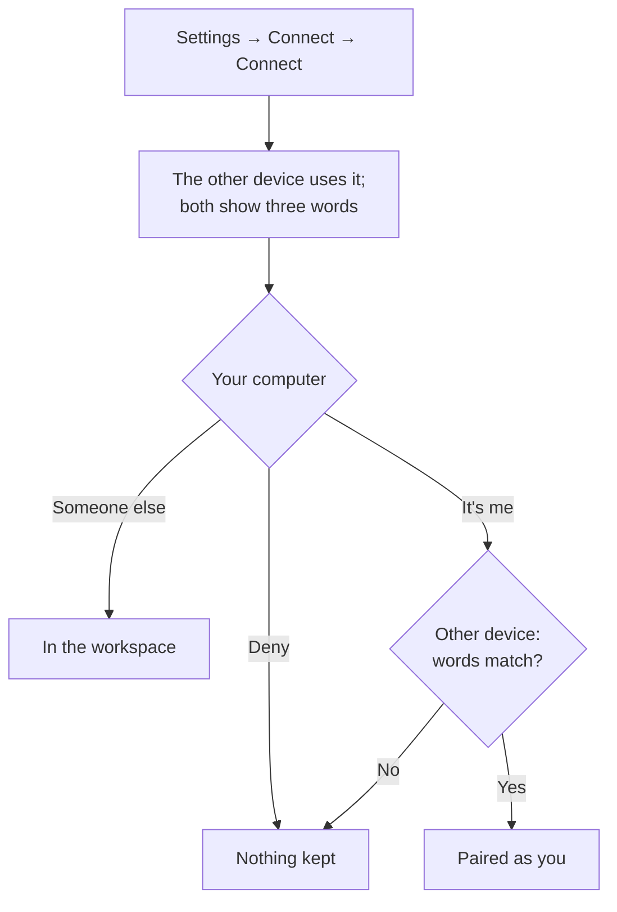

**Development preview.** None of this is in a release yet.

One offer, made on **Settings → Connect**, serves your phone, another computer, or someone else.
You say which when the other device uses it.

## Make an offer

On **Settings → Connect**, press **Connect**. To let someone into a workspace, do it in the
window that shows that workspace; an offer made from Home only pairs your own devices.

The page shows a QR code, six words, **Copy the link** and **Cancel**. The offer works until the
time shown under it (a day), until one device is let in, or until you make another. Three wrong
codes void it.

The six words find your computer on the same network only. From elsewhere, the other device
needs the link. On the default *Local network*, **Reach devices elsewhere…** picks a server
first ([Self-hosting](../self-hosting/)).

## Use it on the other device

| Device | Do |
|---|---|
| Another computer | **Have a code? Join** on Home or on Settings → Connect, or **Join a shared workspace…** in the Layers panel's title menu. Paste the link or type the six words, then **Connect**. |
| Phone app (not published yet) | Scan the QR code. |
| Phone, browser | Turn on **Open in the phone's browser, no app needed** first, then scan the code with the camera: [Phone and browser](../phone/#pair). |

The other device then shows three words and waits for your answer.

## Answer on your computer

The request stays as a notice until you answer; closing it is **Deny**. With Settings → Connect
open, it is on that page instead. It reads *⟨device⟩ wants to connect*, what kind it is, the
profile name it gives, and three words.

Answer only if the other device shows the same three words.

| Answer | What happens | Not offered |
|---|---|---|
| **Deny** | Nothing is kept on either side. | |
| **Someone else**, at **Can view**, **Can edit board** or **Can use terminals** | That device joins the workspace at that role. | for a phone, or an offer made from Home |
| **It's me — the words match** | The other device asks its person whether the words match. On **Yes** (on a computer, **Yes, make this computer ⟨you⟩'s**) it is paired: a computer acts as you from then on, and its workspaces become yours. On **No**, nothing is kept. | for a host, or a computer that already shares a workspace with someone |

A request left unanswered for about three minutes is a no, and so is a confirmation not given
within that time. A host is paired from its own command line: `hive host pair`
([CLI](../cli/#hive-host--an-always-on-host)).

## Your devices

Under **Connected → Your devices**, each paired device shows its kind (*Always on* for a host,
*A computer*, *Phone or browser*) and the day it paired. **Unpair** lets it into nothing on this
computer and takes it off your network if this computer put it there. A phone is forgotten by
your other devices too; a computer or host stays paired with each of your other devices until you
unpair it there.

## People in a workspace

The owner sees **People in this workspace** on the same page: each person, whether they are
*Here now* or *Away*, their role, and **Remove**. **Can drive agents** can be given only to
someone here now, and asks first: they can run commands on your machine through your agents.

| You see | |
|---|---|
| Faces, top right | Who else is in the workspace. The owner clicks them to open Settings → Connect. A guest clicks the face of someone at the host's computer to follow their view; panning or zooming stops following. |
| Named pointers | Where each person points on the canvas; what they selected is ringed in their colour. |
| The banner, as a guest | *You're in ⟨workspace⟩ on ⟨host⟩'s machine · ⟨role⟩*, and **Leave**. |

Each terminal has one keyboard. Its title bar says who has it. Someone who **Can use terminals**
presses **Ask for keyboard**; whoever has it gets **Give** or **Not now**. The owner takes it back
with **Take back**, or Ctrl+Shift+K (⌘⇧K on a Mac) in the terminal.

## Keep a workspace running

A workspace on your computer is offline while the computer sleeps. Under **People in this
workspace**, **Move there** hands it to a host you paired; **Keep it running** says how to pair
one. **Move here**, on the workspace's banner, brings it back. Details:
[`hive host`](../cli/#hive-host--an-always-on-host).

Invite links come from a host's command line, `hive share`; the person pastes one into **Join**.
