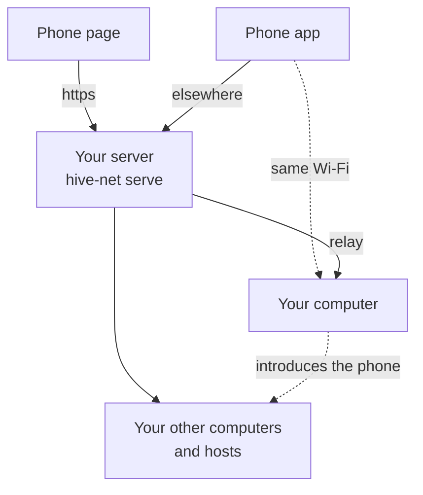
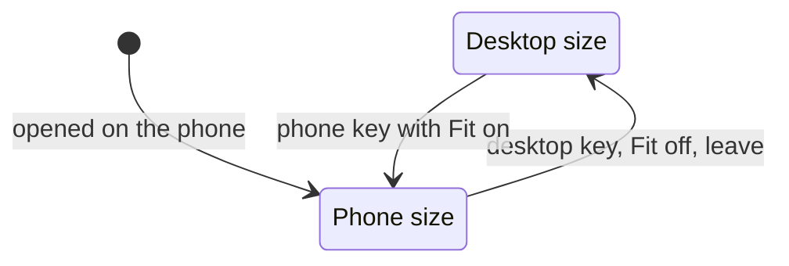

**Development preview.** None of this is in a release yet. The iOS and Android apps are not
published; the page in your phone's browser does what they do.



The phone app is the iOS or Android app. Traffic through the relay is end-to-end encrypted: the
server cannot read it. A browser cannot reach your computer directly, so the page always goes
through the relay.

## Before you start

The page comes from your own network's server, and your computer has to be on that network
(**Settings → Servers**). The default *Local network* has no server, so it offers no page.

The Docker stack in [Self-hosting](../self-hosting/) serves the page at `/phone/`. Use the
setup with a public name: over plain HTTP a phone's browser withholds the keys, camera and
offline copy the page needs. Without Docker, build the page with `crates/hive-web/build.sh` and
serve it:

```bash
hive-net serve --all --data /var/lib/hive-net --domain hive.example.com \
  --phone crates/hive-web/www --views 8443
```

`--views` is the port that serves [views](#views) to the phone, on an origin of their own.

## Pair

1. On the computer: **Settings → Connect → Connect**.
2. Turn on **Open in the phone's browser, no app needed**. The switch shows only when your server
   serves the page. Whoever runs that server is given the code with it: turn it on only if that
   is you.
3. Scan the QR code with the phone's camera. The page asks *Connect to ⟨computer⟩?*; tap
   **Connect**.
4. Both screens show three words. If they match, press **It's me — the words match** on the
   computer, then **Yes** on the phone.

Instead of scanning, **Copy the link** and paste it into the page's field. More on the offer and
the answers: [Connect devices and people](../connect/).

To unpair: **Unpair** on the phone's row under **Your devices** on Settings → Connect, or
**Devices → Forget this computer** on the phone.

Add the page to the home screen. It opens at once with what it last knew, offline too, and
updates itself: a new build is fetched in the background and runs from the next open.

A paired phone runs nothing on your computer. It can start, stop and close agents, answer them,
watch and type into their terminals, and open views. It cannot open a plain terminal, edit the
board, or be a place where a frame runs.

## Home

What needs you comes first, with its answers, longest waiting first. Then **Working**, then
**Pinned**, then every machine, project, frame and tile in the order the desktop's Layers panel
lists them. Each row shows what the agent last said, or what a terminal last printed.

| Do | To |
|---|---|
| Tap a row | open the agent's chat, or a shell's terminal |
| Hold a row, right-click it, or swipe it left | **Stop** or **Close** it |
| **+** in the header or on a project | start an agent |
| Search, or a machine chip | narrow the list |

**+** opens **New agent**: write what it should do, add up to four photos (the agent gets them as
files), and tap **Start**. One line says which agent starts in which folder on which machine; tap
it to change any of them, or the agent's mode and model.

## An agent's chat

Your messages, what the agent says, and the tools it used, folded into one line such as
*Read 3 · Edit 2 · Run 1*. Tap a tool to see its whole input and what it gave back.

The round button sends what you typed. While the agent works and the box is empty, it is
**Stop**. **Close** is in the **⋯** menu.

An agent whose conversation the phone cannot read opens on its terminal instead.

## Answer what an agent asks

The question sits above the message box, and on Home.

| It asks | You see |
|---|---|
| Permission | the tool and the exact command or file; **Allow**, **Deny** |
| A question | each option, with what it means under it; a tap answers |
| Several questions, or one that takes several answers | each question's options (*Choose any* where several fit) and a *Type something* line; one **Send** answers them all once each has an answer |
| A plan | **Read the plan**, **Ask for changes**, **Approve** |

To answer in your own words, type in the message box: it reads *Or type your own answer* while a
question waits.

The first answer counts, from the phone or the desktop. *Not confirmed: check the chat.* means
your computer could not confirm the answer landed. It is never sent twice; look at the chat.

## Terminal

Open it with the terminal icon in a chat's header, or tap a shell on Home. It opens fitted to the
phone. Under it: **Esc**, **Tab**, the arrows, **^C**, the keyboard, and **Fit**.



Whoever typed last sets the size; the phone's keys count only while **Fit** is on. **Fit** on
fits it again at once. **Fit** off gives the terminal back the size it had, unless a
desktop window resized it meanwhile. Allow, Deny and choosing an option do not count as typing.

Pinch to zoom, drag to pan. A swipe scrolls back; in Claude Code, `less` or `vim` it goes to the
program. **New output ↓**, a key or a tap brings back the newest.

## Views

The **Views** tab lists the views installed on your computer that say they work on a phone
(`"phone": true` in `hivemind-view.json`); neither view that comes with the app does yet. Each
runs in a frame of its own, with no access to the page. The server must run with `--views`.

A view that shows the board's [widgets](../widgets/) draws them there, and its buttons work.

## The whole app in a browser tab

**Settings → In a browser → Serve the app to a browser** serves the full app at `http://127.0.0.1:4483/#token=…`, for this computer only. The key changes each
time the app starts; whoever has the link can use your terminals.

For another device, put it behind `tailscale serve` and add the machine's tailnet name under
**More options → Other names**.
