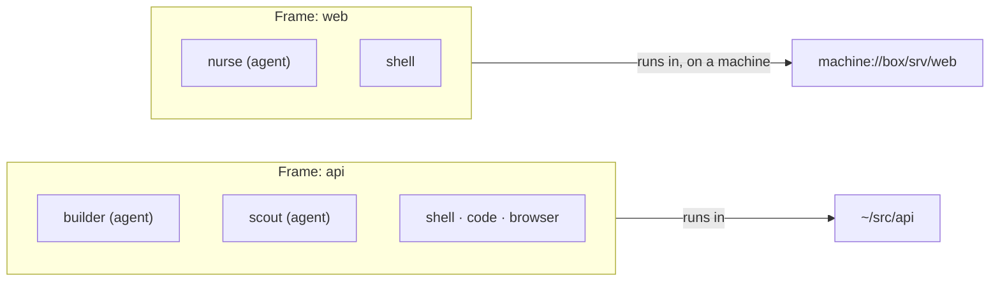

Hivemind runs your coding agents side by side with terminals, a code editor and a browser, in one
window. It shows you which agent is waiting on you.

<Prompt description="Paste this into Claude Code, Codex or any coding agent to install Hivemind and start your first agent." actions={["copy","cursor"]}>
Install Hivemind on this computer and open it on a project with a first coding agent.

1. Find the operating system. On Linux or macOS run `bash <(curl -fsSL https://hivemind.griiken.com/install.sh)`. On Windows, in PowerShell, run `irm https://hivemind.griiken.com/install.ps1 | iex`. On an Intel Mac, stop and tell me: there is no prebuilt app, only `--dev` (a build from source).
2. Check `hive --version` prints a version. If `hive` is not found, add `~/.local/bin` to PATH for this shell and say so.
3. Check which coding-agent CLIs are on PATH (for example `command -v claude codex opencode`). If none, ask me which agent I use and whether to install its CLI; do not install one without my yes.
4. Add the agent I pick: `hive agents install <name> --yes`, then check `hive agents list` shows it switched on.
5. Ask me which project folder to open, then run `hivemind <folder>` there.

If any step needs a password or sudo, ask me to type it myself and wait. At the end, tell me the version installed, the agent added, and that in the app `2` starts that agent in the selected frame.
</Prompt>

<Frame caption="The canvas, with the Layers panel beside it">
  
</Frame>

## How it fits together

A frame binds one folder; every tile inside it starts there, whether that folder is on this
computer or on a saved machine.

| Word | What it is |
|---|---|
| **Workspace** | One project folder and everything open for it. |
| **Frame** | A named area bound to one folder: the project, a git worktree, or a folder on another machine. |
| **Tile** | One thing in a frame: an agent, a terminal, the Code tile, a browser, a tool. |

## What the colours mean

| Colour | Means |
|---|---|
| White | working |
| Amber | needs you |
| Green | done |
| Grey | idle |

Amber always means *a person is being waited on*. The bell in the Layers panel counts those and
jumps to the next one.

## Where to go

<CardGroup cols={2}>
  <Card title="Install" icon="download" href="/getting-started">One command, then your first agent.</Card>
  <Card title="Run agents" icon="bot" href="/agents">Install, start, put to sleep.</Card>
  <Card title="Coordinate agents" icon="network" href="/agent-workflows">One agent drives others with `hive ctl`.</Card>
  <Card title="Use another computer" icon="server" href="/machines">Run agents on a machine over ssh.</Card>
  <Card title="Work with others" icon="users" href="/multiplayer">Share a workspace.</Card>
  <Card title="Extend it" icon="puzzle" href="/plugins">Agents, views, widgets and tools.</Card>
  <Card title="Drive it from a program" icon="code" href="/api">Tokens and the workspace API.</Card>
  <Card title="Use these docs with your agent" icon="sparkles" href="/docs-for-agents">MCP server, llms.txt and a prompt on every page.</Card>
</CardGroup>

These docs follow the latest release; `hive --help` shows what your version has. The iOS and
Android apps are development previews.
