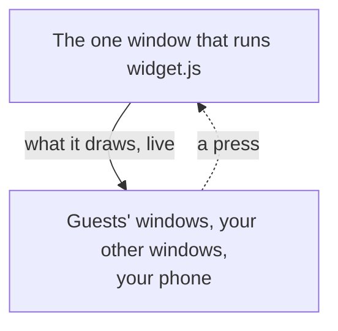

A widget is a small live card whose content your code draws: a counter, a meter of busy agents,
a reminder. Widgets float above every view; drag each one where you want it. Where they sit is
yours alone (kept on your machine), and the eye button hides them all. Which widgets there are,
their order and their state are saved with the workspace.

## Make one

```bash
hive widgets new counter      # ./counter: widget.json, widget.js, hive.d.ts, PROMPT.md
hive widgets install counter
```

`PROMPT.md` is a brief a coding agent can build the widget from: write what you want at the top
and hand it the file. `hive.d.ts` lets an editor check your code against the API.

A widget is a folder holding two files. Add one in **Settings ▸ Plugins**: **Add → Add a widget
from a folder** (it is copied into `~/.config/hivemind/widgets`, so you can move the original).
Switch one off on its page there, or with `hive plugins disable widget:<id>`: it is no longer
offered, and the ones placed keep what they hold but do not run.

`widget.json`

```json
{
  "name": "Counter",
  "icon": "icon.svg",
  "options": [{ "id": "step", "label": "Step", "type": "number", "default": 1 }]
}
```

`icon` names an image in the folder, shown in the Add menu and in Settings. A one-colour SVG on a
24 px grid is drawn in the theme's text colour, like the app's own icons; a PNG is shown as it is.

`widget.js`

```js
const draw = () => hive.render({ type: "stack", children: [
  { type: "number", value: hive.state?.n ?? 0, label: "presses" },
  { type: "button", label: "Press", action: "inc" },
] });
hive.on("start", draw);
hive.on("action", (a) => {
  if (a === "inc") { hive.setState({ n: (hive.state?.n ?? 0) + (hive.options.step ?? 1) }); draw(); }
});
```

Then the toolbar's **Add** → **Counter** adds it to the workspace, in any view (Add lists tools
and widgets by category, with a search). Hover a widget for its options (the gear) and to remove
it.

`options` lists what the person may set on each one placed, in the settings vocabulary every
plugin uses: a `boolean`, a `number` (with `min` and `max`), a `text` (with `maxLength`) or a
`choice` (`values`, and `labels` to show), each with a `default`. The gear draws the form, a
value that does not fit reads as the default, and what they set is shared with everyone in the
workspace.

## What your code gets

| | |
|---|---|
| `hive.render(tree)` | draw the widget |
| `hive.state`, `hive.setState(value)` | what it keeps, saved in the workspace |
| `hive.options` | its options, as set (else their defaults) |
| `hive.on("options", fn)` | the person changed its options |
| `hive.notify(text)` | a desktop notification |
| `hive.moveTo({ x, y }, { over })` | move its card: `x`, `y` from 0 to 1 across the screen (`y: "bottom"`), over `over` ms; every viewer animates it |
| `hive.spot` | where it last moved to |
| `hive.on("click", fn)` | its card was clicked (not on a button) |
| `hive.on("start", fn)` | it was placed or the app opened |
| `hive.on("action", fn)` | one of its buttons was pressed; `fn` gets the button's `action` |
| `hive.on("hm", fn)` | `hive.hm`'s values arrived or changed |
| `hive.hm` | the workspace, as a view sees it: see below |

It runs in a worker: no network, no files, nothing of the app but `hive`. What it draws and its
state are each up to 16 KB of JSON; larger is dropped. Drawings reach others at most 4 times a
second. Its state is saved with the workspace but is never an undo step.

## Widgets without code

A widget can be data and a drawing alone: no `widget.js`. The app's own Sticky note, Checklist
and Text are made this way, and one you install under the same id (`note`, `checklist`, `text`)
replaces them.

```json
{
  "name": "Sticky note",
  "placement": "board",
  "size": { "w": 220, "h": 180 },
  "options": [{ "id": "color", "label": "Colour", "type": "choice",
                "values": ["yellow", "pink", "blue"], "default": "yellow" }],
  "draw": { "type": "stack", "fill": true, "tint": "$options.color",
            "children": [{ "type": "textarea", "placeholder": "Write something" }] }
}
```

- `placement`: `board` puts it on the canvas, moving with its frame; anything else floats over
  every view.
- `input`, `textarea` and `list` are what people write in: the widget's text, merged by character
  when two people type at once, and its lines, ticked, added and reordered. Writing in it is an
  edit, so ⌘Z takes it back.
- `"$options.<id>"` in a drawing is that option's value; `tint` colours the card as a note.
  A widget with code tints its card the same way: `hive.render({ type: "stack", tint: "pink", … })`,
  on the board and floating.
- Options are `number`, `boolean`, `text` or `choice` (with `values`).

A widget with code can draw these fields too.

## The workspace

`hive.hm` is the client a view and a tool's tile have ([Extension authoring](../extension-authoring/#permissions)): the workspace's frames
and tiles, its agents' status and what happens to them, and the commands and requests a view
has, each held to the permissions its `widget.json` asks for, as a view's are:

```json
{ "name": "Agents at work", "permissions": ["workspace:spawn", "workspace:prompt"] }
```

```js
hive.hm.on("structure", ({ tiles }) => {
  const agents = tiles.filter((t) => t.agent);
  for (const t of agents) hive.hm.subscribeStatus(t.id, (status, info) => { /* info.agent.waitingFor … */ });
});
hive.hm.onEvents(["turn", "needsInput"], (e) => hive.notify(`${e.kind} in ${e.tileId}`));
await hive.hm.commands.spawnAgent(null, null, { prompt: "run the tests" }); // you send or cancel it
```

In a widget every call returns a promise, and one given a callback returns its unsubscribe at
once. Its values (`hive.hm.hello`, `settings`, `capabilities`, `features`) are there to read from
the first line of your code, each in its usual shape: empty (`[]`, `{}`, `hello` null) until the
app sends them, when `hive.on("hm", fn)` fires, as it does again when they change. Draw again
there:

```js
const draw = () => hive.render({ type: "text", text: hive.hm.capabilities.includes("workspace:spawn") ? "Ready" : "Waiting" });
hive.on("hm", draw);
draw();
```

A widget's page in **Settings ▸ Plugins**, **What it can do**, shows its permissions. A widget
without permissions reads and points at things, nothing more.

## What it can draw

| Node | Fields |
|---|---|
| `stack`, `row` | `children` |
| `text` | `text`, `size: "large"`, `muted: true` |
| `number` | `value`, `label` |
| `meter` | `value`, `max`, `label` |
| `button` | `label`, `action` |
| `image` | `src` (an image in its folder), `w`, `h` |
| `sprite` | `src` (a sheet of frames), `frameW`, `frameH`, `row`, `frames`, `fps`, `scale`, `flip` |

Images (`.png`, `.gif`, `.webp`, `.jpg`, `.svg`, up to 1 MB each) go in the widget's folder; guests
get them from the host. `"chrome": "none"` in `widget.json` drops the card, for a pet that walks
the screen.

## Where they run



The window that runs it is on the machine that hosts the workspace, or, for a workspace on a
`hive host` with no window, your own laptop or desktop that has it open. Nobody else's computer
runs your code, and nobody installs anything to see it. What it draws is never saved. A guest who
can edit the board can press its buttons; one who can only view cannot.

On your phone, a view that shows widgets draws them and its buttons work, for example
`hive views install @dip497/widgets` on the computer that hosts the workspace ([Phone and
browser](../phone/#views)).

## Share one on HiveHub

Give it an id in your own GitHub scope and a version, and publish its folder. Publish a higher
version and everyone who has it is offered the update in Settings ▸ Plugins:

```json
{ "id": "@you/counter", "name": "Counter", "version": "1.0.0", "icon": "icon.svg" }
```

```sh
hivehub publish widgets/counter
```

An agent can run what a widget declares in `widget.json`'s `"commands"` (a name, a
`description`, and `args`: a line saying what its JSON argument holds) while the widget is on the
board. The widget answers each with `hive.hm.onCommand(name, handler)`; what the handler returns
is the agent's answer:

```js
hive.hm.onCommand("add", (a) => { save({ steps: [...steps(), { text: a.text, done: false }] }); return { index: steps().length - 1 }; });
```

```sh
hive ctl plugin call @dip497/progress add '{"text":"Run the tests"}'
```

`examples/widgets/progress` is a widget agents keep: a task's steps, added and ticked off by them.

A `"category"` in `widget.json` says what it is for: `code`, `git`, `agents`, `productivity`, `monitoring`, `team`, `web`, `fun` or `other` (the default). The Add menu
groups widgets by it, beside the tools.

A `README.md` beside `widget.json` is shown on its page, on HiveHub and in Settings ▸ Plugins,
before anyone installs it. People install it from the **HiveHub** tab of Settings ▸ Plugins, or with:

```sh
hive widgets install @you/counter   # every file checked against the hash HiveHub recorded
hive widgets list
hive widgets remove @you/counter    # what each placed one holds stays on its board
```

`hive widgets install <folder>` adds one from a folder on this computer.
